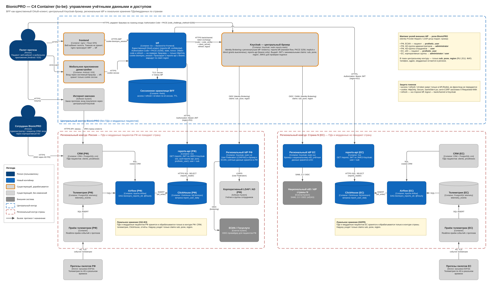

# Задание 1. Повышение безопасности системы

## Задача 1. Архитектура управления учётными данными

Диаграмма C4 (Container, to-be): [`BionicPRO_C4_security_to-be.drawio`](./BionicPRO_C4_security_to-be.drawio)

Уязвимости исходной схемы:
- публичный клиент без PKCE: перехваченный code можно обменять на токены;
- access и refresh токены хранятся в браузере (`keycloak-js`) и доступны XSS;
- включён Password grant (`directAccessGrantsEnabled`).

### 1. Унификация доступа и локальное хранение данных
- Центральный Keycloak работает только брокером (Identity Brokering) и не хранит пациентов.
- В каждой стране есть региональный контур:
  - региональный IdP;
  - источник учётных записей: LDAP/AD через User Federation, ЕСИА по OIDC, национальный eID по SAML/OIDC;
  - CRM, телеметрия, ClickHouse и сервис отчётов.
- ПДн и медданные не покидают страну. В центральный контур попадают только claims `sub`, роли и `region`.
  По `region` BFF направляет запрос в региональные сервисы.

### 2. Токены не передаются фронтенду (BFF)
- Единственный OAuth-клиент — BFF (`reports-bff`, confidential): Authorization Code + PKCE (S256), `state`, `nonce`.
- Access, refresh и id token хранятся в сессионном хранилище BFF (Redis).
- Браузер и мобильное приложение получают только cookie `bionicpro_session` (`HttpOnly`, `Secure`, `SameSite=Lax`).
- Refresh и logout выполняет BFF. К API он обращается с `Authorization: Bearer`.
- Защита от CSRF: обязательный заголовок `X-Requested-With`.

### 3. Внешние удостоверяющие службы разных стран
- Новая страна подключается как Identity Provider (OIDC/SAML) или User Federation (LDAP/AD) в брокере.
- Identity Provider Mappers приводят внешние роли к ролям BionicPRO: `prothetic_user`, `administrator`, `user`.
- Код сервисов при подключении нового IdP не меняется.

## Задача 2. PKCE вместо Code Grant

PKCE реализован в BFF, а не в SPA: по задаче 1 токены IdP не должны попадать во фронтенд, поэтому
OAuth-клиент только серверный.

| Файл | Что сделано |
|---|---|
| [`keycloak/realm-export.json`](../keycloak/realm-export.json) | Клиент `reports-bff`: `pkce.code.challenge.method=S256` (без `code_challenge` Keycloak отклоняет запрос), implicit и password grant выключены, redirect только на `/bff/auth/callback`, в `aud` добавлен `reports-api` |
| [`backend/internal/bff/server.go`](../backend/internal/bff/server.go) | `login`: генерирует `code_verifier`, `state`, `nonce`, verifier хранит на сервере; `callback`: проверяет `state` (одноразово), обменивает code с verifier, проверяет `nonce`, создаёт сессию |
| [`backend/internal/bff/provider.go`](../backend/internal/bff/provider.go) | `AuthCodeURL` (`code_challenge=S256(verifier)`), `Exchange` (code + `code_verifier`), проверка подписей id/access token по JWKS |
| [`frontend/`](../frontend) | `keycloak-js` удалён, SPA работает через `/bff/*` (nginx, тот же origin) |

Результат:
- перехваченный code бесполезен без `code_verifier`, который не покидает BFF;
- токенов в браузере нет.
