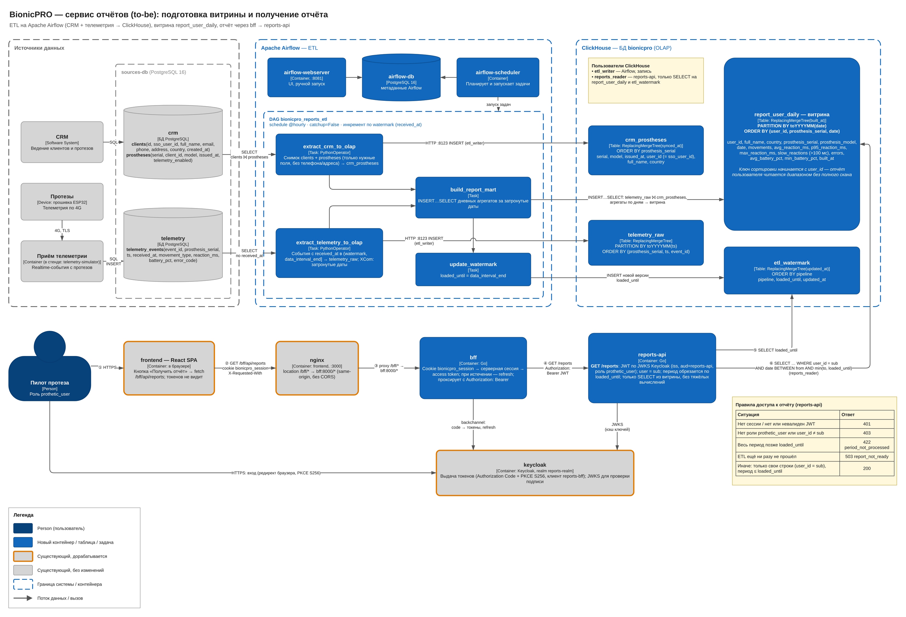
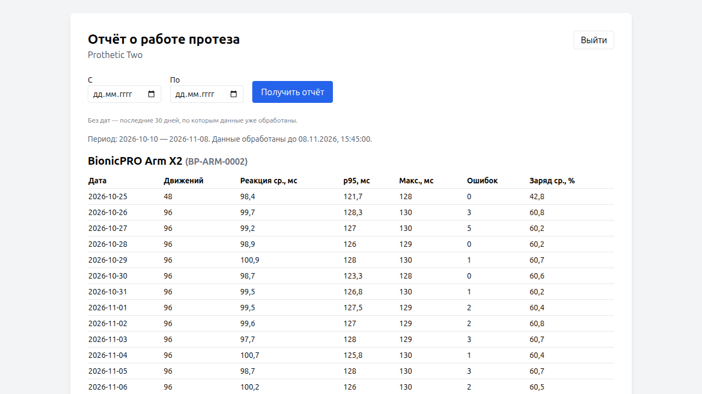

# Задание 2. Сервис отчётов

## Задача 1. Архитектура

Диаграмма: [`BionicPRO_reports_to-be.drawio`](./BionicPRO_reports_to-be.drawio)



CRM и телеметрия (Postgres, OLTP) остаются источниками. Airflow по расписанию переносит данные в ClickHouse (OLAP)
и собирает витрину `report_user_daily`. Сервис отчётов читает только витрину.

| Компонент | Каталог |
|---|---|
| Источники: CRM, телеметрия, симулятор телеметрии | [`sources/`](../sources) |
| Схема ClickHouse, пользователи `etl_writer` / `reports_reader` | [`clickhouse/init/`](../clickhouse/init) |
| Airflow: DAG и SQL витрины | [`airflow/`](../airflow) |
| `reports-api` и BFF (Go) | [`backend/`](../backend) |
| UI | [`frontend/src/components/ReportPage.tsx`](../frontend/src/components/ReportPage.tsx) |

## Задача 2. Airflow DAG

[`airflow/dags/bionicpro_reports_etl.py`](../airflow/dags/bionicpro_reports_etl.py):

```
[extract_crm_to_olap, extract_telemetry_to_olap] >> build_report_mart >> update_watermark
```

| Задача | Что делает |
|---|---|
| `extract_crm_to_olap` | клиенты и протезы из CRM → `crm_prostheses` (только поля для отчёта, без телефона и адреса) |
| `extract_telemetry_to_olap` | события с `received_at` в окне (watermark; `data_interval_end`] → `telemetry_raw` |
| `build_report_mart` | [`INSERT … SELECT`](../airflow/dags/sql/build_report_mart.sql) дневных агрегатов по клиенту и протезу за затронутые даты → `report_user_daily` |
| `update_watermark` | `etl_watermark.loaded_until = data_interval_end` |

- **Расписание:** `@hourly` (на стенде `*/5 * * * *` через `REPORTS_ETL_SCHEDULE`), `catchup=False`, `max_active_runs=1`.
- **Витрина:** `PARTITION BY toYYYYMM(date)`, `ORDER BY (user_id, prosthesis_serial, date)`. Отчёт пользователя читается
  диапазоном первичного ключа.

## Задача 3. API `/reports`

[`backend/internal/reports`](../backend/internal/reports), точка входа [`backend/cmd/reports`](../backend/cmd/reports).

`GET /reports?from=YYYY-MM-DD&to=YYYY-MM-DD`. Параметры необязательны, по умолчанию берутся последние 30 обработанных дней.

1. `SELECT loaded_until FROM etl_watermark` — до какого момента данные обработаны Airflow.
2. Период обрезается по `loaded_until`:
   - весь период позже → `422 period_not_processed`;
   - ETL ещё не запускался → `503 report_not_ready`;
   - обрезана часть → `truncated: true`.
3. `SELECT … FROM report_user_daily WHERE user_id = ? AND date BETWEEN ? AND ?` — без агрегаций.

## Задача 4. Доступ только к своему отчёту

- **BFF:** без сессии → `401`.
- **reports-api**, проверка JWT:
  - подпись по JWKS Keycloak, `iss`, `exp`, `aud=reports-api`, иначе → `401`;
  - нужна роль `prothetic_user`, иначе → `403`.
- **Пользователь — только `sub` из токена.** `user_id`, отличный от `sub`, → `403`. Связь с CRM: `clients.sso_user_id = sub`.
- **ClickHouse:** у `reports_reader` только `SELECT` на витрину и watermark.

## Задача 5. UI

Кнопка «Получить отчёт» вызывает `GET /bff/api/reports`: nginx → BFF → `reports-api` → ClickHouse.



## Запуск и проверка

```bash
docker compose up -d --build        # если порт 8080 занят: KEYCLOAK_PORT=18080 docker compose up -d --build
```

| Что | Адрес, учётные данные |
|---|---|
| Приложение | http://localhost:3000 — `prothetic1` / `prothetic123` (`prothetic2` — два протеза, `prothetic3` — телеметрия отключена), `user1` / `password123` — без роли |
| Keycloak | http://localhost:8080 — admin / admin |
| Airflow | http://localhost:8081 — admin / admin |
| ClickHouse | http://localhost:8123 — admin / admin_pw |

Realm импортируется только при первом старте. После изменения `realm-export.json` удалите `./postgres-keycloak-data`.

| Проверка | Ожидается |
|---|---|
| `curl -i -H 'X-Requested-With: x' http://localhost:3000/bff/api/reports` без входа | `401` |
| вход `user1` → «Получить отчёт» | `403` |
| вход `prothetic1` → «Получить отчёт» | только свой протез |
| `/bff/api/reports?user_id=<чужой sub>` | `403` |
| период позже `processed_until` | `422 period_not_processed` |
| `curl 'http://localhost:8123/?user=reports_reader&password=reports_reader_pw' --data 'SELECT date, movements FROM bionicpro.report_user_daily FINAL WHERE user_id = '\''7c1e4a52-3b8d-4f0e-9a61-2d5f8c9e0a11'\'' ORDER BY date'` | те же числа, что в UI у `prothetic1` |

Тесты: `cd backend && go test ./...`.
